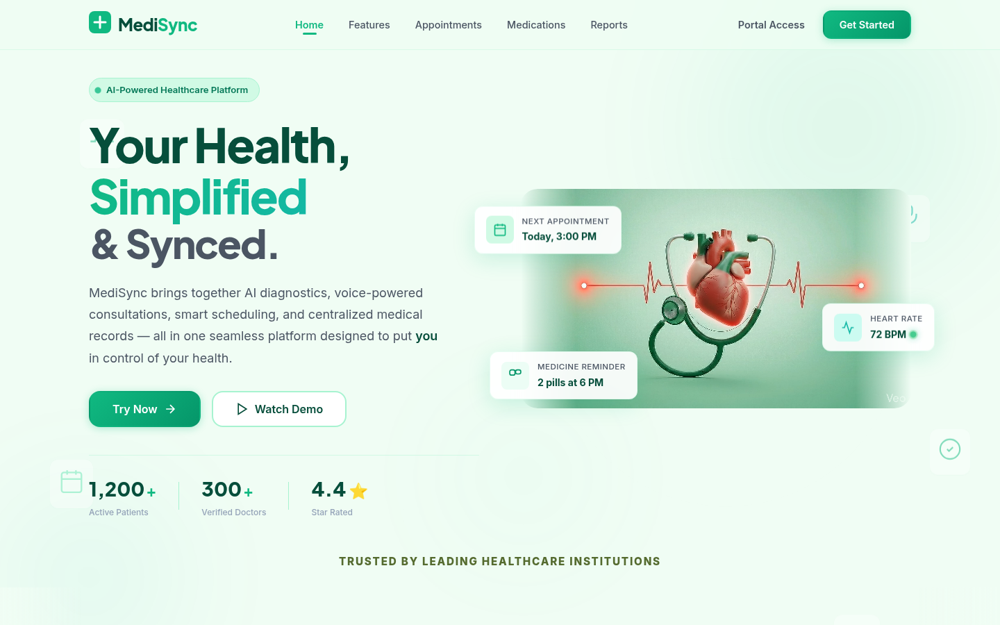
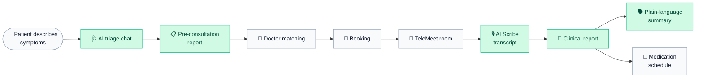

<div align="center">


# MediSync

### Your health, simplified & synced.

An AI-powered healthcare platform that takes a patient from **first symptom to follow-up**:<br/>
AI triage → doctor matching → booking → tele-consultation → clinical report → medication tracking.

<br/>


<br/>

[Features](#-features) ·
[How it works](#-how-it-works) ·
[Tech stack](#-tech-stack) ·
[Getting started](#-getting-started) ·
[Database](#-database) ·
[Project structure](#-project-structure)

<br/>



</div>

<br/>

## ✨ Features

<table>
<tr>
<td width="50%" valign="top">

### 🩺 AI Health Assistant
A conversational triage that interviews the patient like a clinician: one focused question at a time, with tappable quick-reply options. It stops on its own once it has enough, then produces a structured **pre-consultation report** (complaint, symptoms, severity, urgency, recommended specialty) that can be downloaded as a PDF.

</td>
<td width="50%" valign="top">

### 📍 Smart Doctor Matching
The recommended specialty and its AI-generated synonyms are matched against a directory of **5,000 doctor profiles across 14 specialties**. Results can be sorted by rating, experience, fee, or distance from the patient (browser geolocation + Haversine).

</td>
</tr>
<tr>
<td width="50%" valign="top">

### 📅 Booking & Scheduling
Pick a date, slot, and mode (video or in-person) with the clinic shown on a live map. Booked slots are blocked automatically so they can't be double-booked. Patients can reschedule from their appointments dashboard.

</td>
<td width="50%" valign="top">

### 🎥 TeleMeet Consultation Room
Separate doctor and patient rooms with camera preview and a realtime **ready-state handshake** over Supabase Realtime, so each side sees when the other has joined. The doctor has the patient's triage report beside them throughout.

</td>
</tr>
<tr>
<td width="50%" valign="top">

### 🎙️ AI Scribe
During the consult, the doctor's speech is transcribed live in the browser (Web Speech API) into a notepad. One click turns the transcript and the triage report into a full **clinical report**: diagnosis, summary, prescriptions, precautions, red flags, and follow-up.

</td>
<td width="50%" valign="top">

### 📄 Plain-language Reports
Patients get every clinical report in their dashboard, plus a **"explain it simply"** summary that rewrites the jargon into everyday language: what's wrong, what to do, what to avoid, what each medicine is for, and which danger signs mean "go to hospital".

</td>
</tr>
<tr>
<td width="50%" valign="top">

### 💊 Medication Tracker
Prescriptions are extracted from a clinical report and synced into a daily schedule in one click, or added by hand. Each dose is ticked off per day, building an intake history.

</td>
<td width="50%" valign="top">

### 👩‍⚕️ Doctor Portal
A dedicated dashboard for providers: incoming bookings, a calendar view, patient details with the triage report, appointment status management, and one-click entry to the consultation room.

</td>
</tr>
</table>

## 🔄 How it works



<sub>Green steps are AI-generated.</sub>

### Which model does what

| Task | Primary model | Fallback |
| :-- | :-- | :-- |
| Triage conversation | Llama 3.1 8B Instant (Groq) | — |
| Pre-consultation report | Gemini Flash-Lite, schema-constrained JSON | Llama 3.3 70B (Groq) |
| Clinical consultation report | Gemini Flash-Lite, schema-constrained JSON | Llama 3.3 70B (Groq) |
| Medication extraction | Llama 3.3 70B (Groq) | — |
| Plain-language summary | Llama 3.3 70B (Groq) | — |

Every Gemini call is wrapped with an automatic Groq fallback, so report generation keeps working if one provider is unavailable.

## 🧰 Tech stack

| Layer | Tools |
| :-- | :-- |
| **Frontend** | React 18, React Router 6, Vite 5, plain CSS, Lucide icons |
| **AI** | Google Gemini (`@google/generative-ai`), Groq (`groq-sdk`) |
| **Backend** | Supabase — Postgres + Realtime |
| **Maps** | Leaflet + React Leaflet |
| **Documents** | jsPDF + html2canvas |
| **Browser APIs** | Web Speech (transcription), MediaDevices (camera), Geolocation |
| **Hosting** | Vercel (SPA rewrites in `vercel.json`) |

## 🚀 Getting started

### Prerequisites

- **Node.js 18+**
- A [Supabase](https://supabase.com) project
- A [Google AI Studio](https://aistudio.google.com/apikey) API key
- A [Groq](https://console.groq.com/keys) API key

### Install & run

```bash
git clone https://github.com/beastb728/medsync.git
cd medsync
npm install
cp .env.example .env    # then fill in your keys
npm run dev
```

The app starts at `http://localhost:5173`.

### Environment variables

| Variable | Description |
| :-- | :-- |
| `VITE_SUPABASE_URL` | Your Supabase project URL |
| `VITE_SUPABASE_ANON_KEY` | Supabase anon (public) key |
| `VITE_GEMINI_API_KEY` | Google Gemini API key |
| `VITE_GROQ_API_KEY` | Groq API key |

### Scripts

| Command | What it does |
| :-- | :-- |
| `npm run dev` | Start the dev server with hot reload |
| `npm run build` | Production build into `dist/` |
| `npm run preview` | Serve the production build locally |

## 🗄️ Database

MediSync expects these tables in Supabase:

| Table | Purpose | Key columns |
| :-- | :-- | :-- |
| `patients` | Patient accounts | `id`, `password`, `name` |
| `doctors` | Doctor accounts and profiles | `id`, `password`, `name`, `specialty`, `experience`, `rating`, `consultation_fee`, `clinic_name`, `address`, `slots`, `location`, `relevant_specializations` |
| `appointments` | Bookings, triage and clinical reports | `case_id`, `patient_id`, `doctor_id`, `appointment_date`, `appointment_time`, `mode`, `status`, `pre_report`, `generated_report`, `doctor_ready`, `patient_ready` |
| `blocked_slots` | Slots that are no longer bookable | `doctor_id`, `appointment_date`, `appointment_time` |
| `medications` | A patient's active prescriptions | `patient_id`, `name`, `dosage`, `frequency`, `times`, `notes`, `status` |
| `medication_intake` | Per-dose intake log | `medication_id`, `patient_id`, `date`, `time_index`, `taken` |

> [!TIP]
> Enable **Realtime** on the `appointments` table — the TeleMeet handshake listens for `UPDATE` events on it.

**Seeding doctors:** the directory lives in [`public/doctors.json`](public/doctors.json). With the app running, open `/migrate` to upsert it into the `doctors` table. To regenerate the directory, run `node scripts/generate_doctors.js`.

## 🧭 Routes

| Path | Page | Access |
| :-- | :-- | :-- |
| `/` | Landing page | Public |
| `/login` | Patient / provider sign-in | Public |
| `/chat` | AI triage → report → doctor match → booking | Public |
| `/telemeet` | Consultation room (doctor or patient view) | Public |
| `/appointments` | Patient appointments | Patient |
| `/medications` | Medication tracker | Patient |
| `/reports` | Clinical reports and summaries | Patient |
| `/doctor-portal` | Doctor dashboard | Doctor |
| `/migrate` | Doctor directory seeding utility | Public |

## 📁 Project structure

```
medsync/
├── public/
│   ├── doctors.json          # Doctor directory (5,000 profiles)
│   ├── doctorasset/          # Doctor profile pictures
│   ├── brands/               # Partner logos
│   └── features/             # Feature showcase videos
├── scripts/
│   └── generate_doctors.js   # Directory generator
├── src/
│   ├── components/
│   │   ├── ChatFlow/         # Triage chat, pre-report, doctor match, booking
│   │   ├── Doctor/           # Doctor navbar, calendar, patient detail modal
│   │   ├── Features/         # Landing: feature showcase
│   │   ├── Hero/             # Landing: hero + navbar
│   │   └── Footer/
│   ├── contexts/
│   │   └── AuthContext.jsx   # Session + role (patient / doctor)
│   ├── lib/
│   │   ├── gemini.js         # Schema-constrained report generation
│   │   ├── groq.js           # Triage chat, fallbacks, summaries
│   │   └── supabase.js       # Supabase client
│   ├── pages/                # Dashboards, TeleMeet, Medications, Reports, Login
│   ├── App.jsx               # Routes + role-protected wrappers
│   └── main.jsx
├── index.html
├── vercel.json
└── vite.config.js
```

## ⚠️ Project status

MediSync is a **prototype built for demonstration**, not a certified medical product.

- AI output is informational only and is **not a diagnosis**. Always consult a qualified clinician.
- Sign-in is a simple ID + access-key lookup intended for demos; it is not production-grade authentication.
- API keys are used from the browser. For a real deployment, move AI calls behind a server and enable Supabase Row Level Security.
- The doctor directory, ratings, and landing-page testimonials are generated sample data.

## 🙏 Acknowledgements

Forked from [arpit-raj-001/medsync](https://github.com/arpit-raj-001/medsync).

<div align="center">
<br/>
<sub>Built with React, Supabase, Gemini and Groq.</sub>
</div>
